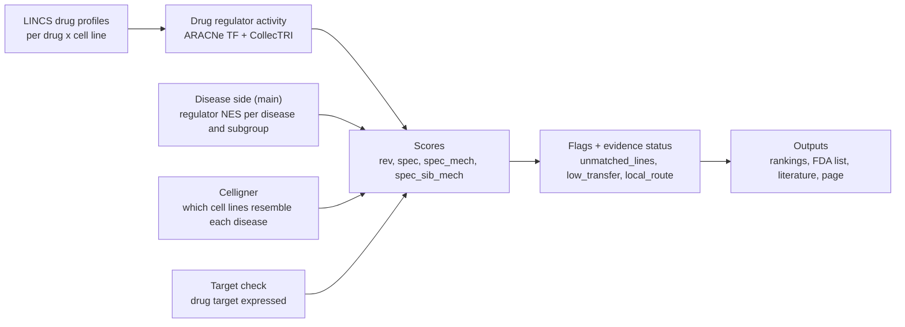

# Drug side v2: steps, decisions and outputs

Last updated 2026-11-02 (checked against the code and results). How drugs are matched to diseases, step by step: what
each step does and why, the command, inputs, outputs and decisions. Docs live on `main`; drug-side code can also be
run from the `celligner` worktree (`~/projects/repurposing-celligner`). The disease side (signatures, master
regulators, subgroups) is in [`PIPELINE_V2.md`](PIPELINE_V2.md); decisions in [`DECISIONS.md`](DECISIONS.md)
(D-numbers) and [`notes/drug_side_decisions_and_caveats.md`](notes/drug_side_decisions_and_caveats.md) (drug-side
choices and caveats C1-C25); reporting requirements in [`LLM_COORDINATION_NOTES.md`](LLM_COORDINATION_NOTES.md).

Plain-language version with results: [`DRUG_SIDE_PLAIN_LANGUAGE.md`](DRUG_SIDE_PLAIN_LANGUAGE.md).

To run: [`scripts/run_v2_drug.sh`](../scripts/run_v2_drug.sh) (`list`, `show <step>`, or step names in order). Run the
disease side first (`scripts/run_v2.sh`); in the `celligner` worktree, then `sync_disease` (a no-op on `main`).

## The idea in one paragraph

A cancer changes the activity of many regulators (transcription factors) compared with healthy tissue. A drug also
changes regulator activity in the cell lines it was tested on (LINCS). A drug is a candidate if it pushes the disease's
regulators back toward healthy (reversal), more so for this disease than for cancers in general (specificity), and
not only by stopping cell division (proliferation split). Every candidate list says how good the underlying cell-line
evidence is (evidence status).

## Steps

### 1. Cell-line matching (Celligner; v1, unchanged)
- `70_celligner.py` -> `74_celligner_matrices.py`: tumors and DepMap cell lines are aligned so their expression is
  comparable; each patient gets weights over the lines most like them.
- **Lines from the same tissue only** (tissue key, `config/celligner_tissue_keys.tsv`), because the match is about
  whether a drug's effect applies, not about the closest line anywhere (2026-10-08). Substitutes where a tissue has no
  usable lines (thymoma -> T-cell lines; PCPG -> neuroblastoma lines). Blood split into myeloid / lymphoid (2026-10-12).
- **Subgroups** (`subgroup_line_weights`, `74b_stratum_line_weights.py` VERSION=v2): a subgroup's weights are the mean
  of its own patients' weights.
- Outputs: `results/celligner/disease_line_weights_long.tsv`, `stratum_line_weights_long_v2.tsv`,
  `stratum_line_summary_v2.tsv`.

### 2. Drug data (LINCS; v1, unchanged)
- `76`, `76b`, `79a`, `79c`: LINCS 2020 level-5 signatures, high quality and active (TAS >= 0.4), in cancer lines; genes
  = measured + best-inferred (~10,000). Per drug and line one consensus profile.
- **Each line's average drug response is removed** ("specific" profiles), because almost every active drug slows
  growth; without this, most drugs looked like they reversed every cancer.
- A drug not tested in the disease's own tissue is **borrowed** if tested in >= 3 other cancer lines (2026-10-09).
- Annotations (`79a`): targets, mechanism, approval (ChEMBL phase 4 or Repurposing Hub "Launched": approved anywhere).

### 3. Target check (`79b`; `subgroup_target_gate` for subgroups)
- A drug stays on a disease's list if one of its own annotated targets is expressed (TPM >= 1 in >= 20% of the
  disease's tumors). Drug-handling genes never count; no family rescue (a paralog cannot stand in for the target).
  Subgroups: judged on the subgroup's own tumors.
- Outputs: `results/lincs/disease_drugs.tsv`, `stratum_drugs_v2.tsv`.

### 4. Drug regulator activity (`drug_viper_*`, `79d_drug_viper.R`)
- VIPER on every drug x line profile with: the ARACNe TF-only regulons of each cancer's network (VERSION=v2 REGSET=tf)
  and CollecTRI (REGULON=collectri, one context-free regulon). DoRothEA is also scored (not used in the ranking).
- **Why two regulon sets (D75):** the tumor network learns which genes rise and fall together across patients. For
  ESR1 this includes lineage genes (GATA3, FOXA1) that anti-estrogens raise in MCF7, so ER blockade read as ER
  activation. CollecTRI's ESR1 targets are direct targets and read the drugs correctly. Shadow correction and the
  luminal-only network did not fix it (caveat C18).
- **Knockdown benchmark** (`knockdown_subset`, `knockdown_benchmark`, `79m` / `79n`): LINCS shRNA and CRISPR knockdowns
  of 336 TFs. All regulon sets detect knockdowns weakly and about equally, with too little data to pick a set per TF
  (C19), so both sets are averaged instead. Reported, not used.
- **Overexpression added (D84, `79u`, `79n` PERTURB=d84, `79v`):** neither set wins (57 TFs, p = 0.15), so the
  consensus stays; 4 per-TF switches and per-regulator flags in `results/lincs/d84_choice.tsv` (not yet applied).
- **Cell-type networks (D97, 2026-11-03):** groups in split cohorts with >= 85 tumors score drugs on their own
  network (`config/group_networks.tsv`); full drug-activity rerun, which also refreshed the regulator filter. Effect
  (D96 full-pipeline test): anti-estrogens in basal breast 97th -> 77th percentile, luminal controls 26 -> 41, known-use
  and dependency checks unchanged or better, 12 more drugs reverse >= 80% of cancers (they stay mid-ranked on
  `spec_mech`). Earlier attempts and literature: D92-D96 in `DECISIONS.md`, `LITERATURE_NETWORKS.md`.
- Outputs: `data/processed/lincs/drug_viper_specific_v2_tf/<NET>.f32`, `drug_viper_specific_collectri/ALL.f32` (not in
  git); regulator tables `results/lincs/drug_viper_regulators_*.tsv`.

### 5. Proliferation-linked regulators (`prolif_regulators_*`, `79h`)
- Per regulon set: regulators whose targets are enriched for proliferation genes (Hallmark E2F + G2M, FDR < 0.05,
  fold >= 2). Used by the split in step 9. Outputs: `results/lincs/prolif_regulators_v2_tf.tsv`,
  `prolif_regulators_collectri.tsv`.

### 6. Borrowed-drug transfer confidence (`transfer_confidence`, `79l` VERSION=v2; run before ranking)
- Predicts how well a drug's average profile in other lines matches its profile in an unseen line, from the drug's
  consistency across lines (leave-one-line-out data, `77`). Well calibrated.
- A distance term (how far the disease is from the drug's tested lines) was added as agreed and **adds nothing** once
  consistency is known: how well a borrowed drug carries over is a property of the drug (C21).
- **Flag `low_transfer` (D77):** borrowed and confidence < 0.5 (fixed from the distribution before rankings; 11.5% of
  borrowed pairs). Output `results/lincs/drug_transfer_confidence_v2.tsv`.

### 7. Ranking per disease (`ranking`, `79e` VERSION=v2 REGULON=consensus)
- **Drug activity per disease:** tested in the disease's tissue -> average over those lines, weighted by the disease's
  Celligner weights; borrowed -> plain average over all its other cancer lines.
- **Consensus (D75):** per regulator, the mean of the ARACNe TF and CollecTRI values, over the sets where the regulator
  is scored on both the disease and the drug side.
- **Reversal (`rev`, D74):** `rev = - sum_i NES_i * a_i / sqrt(sum_i NES_i^2)` over every regulator tested in the
  disease (NES_i = disease activity change, a_i = drug activity). Positive = the drug pushes regulators back toward
  healthy. **No master-regulator cutoff:** FDR-cut lists changed a lot with small changes to the null while the
  ranking did not (D73).
- **Specificity (`spec`):** `rev` robust-z-scored within the disease, minus the mean of the same drug activity scored
  against every disease from other tissues (each robust-z-scored). Positive = reverses this disease more than cancers
  in general. Same-tissue diseases are excluded so subtypes do not count against each other.
- **Flag `unmatched_lines` (D76):** a direct drug whose best tested line has < 0.1 of the Celligner weight of the
  disease's best line in the tissue (cutoff fixed from the bimodal distribution). Example: basal breast anti-estrogens,
  tested only in MCF7 (luminal), ranked 97-100th for the wrong reason (C20).
- **Tiers:** 1 = approved anywhere + passes target check + top 10% + not flagged; 2 = same but not approved; 3 = rest.
  Flagged drugs stay in the ranking but never in tiers 1-2.
- **Evidence status per disease (D78):** `matched` (a tier 1-2 drug was tested in a matching line), `borrowed only`, or
  `no adequate compound`, with a sentence for reports (`evidence_note`). v2: 14 of 41 diseases matched.
- Outputs: `results/lincs/drug_reversal_v2_consensus.tsv`, `drug_reversal_summary_v2_consensus.tsv`,
  `drug_reversal_controls_v2_consensus.tsv`.

### 8. Ranking per subgroup (`ranking_subgroups`, `79e` STRATA=1)
- Same as step 7 for the 14 subgroups (main D79), using each subgroup's master regulators and line weights and its
  parent's tissue key, network and transfer confidence. Adds **sibling specificity (`spec_sib`)**: this subgroup vs its
  sibling subgroup. Replaces `79g` for v2.
- Outputs: `results/lincs/stratum_reversal_v2_consensus.tsv`, `stratum_reversal_summary_v2_consensus.tsv`.

### 9. Proliferation split (`split`, `79i`)
- Proliferation-linked regulators (step 5, or whose drug activity tracks the drug's effect on proliferation genes,
  |r| >= 0.5) are separated; the remaining activity is adjusted for each drug's proliferation effect.
- Scores: `rev_prolif` (reversal through proliferation), `rev_mech` (the rest), **`spec_mech`** (specificity of the
  mechanism part), for subgroups **`spec_sib_mech`**; `prolif_share` = share of the reversal from proliferation.
  A regulator counts as proliferation-linked if linked in either regulon set.
- **Reports lead with `spec_mech` / `spec_sib_mech` (D80):** by `rev` the same drugs top most cancers (statins,
  palbociclib, MEK inhibitors, anthracyclines; 32 drugs in the top 10% of >= 20 groups); by `spec_mech` none.
- Outputs: `results/lincs/drug_reversal_split_v2_consensus.tsv`, `stratum_reversal_split_v2_consensus.tsv`,
  `split_overview_v2_consensus.tsv`, `split_controls_v2_consensus.tsv`.

### 9a. Target presence in the ranking (`79i2`; D102a, adopted as D102c 2026-11-04)
- Runs after `79i`, in place on the two split tables (backups `*_pre_d102.tsv`; idempotent from `*_pregate` columns).
- A drug with ChEMBL-backed targets (curated mechanism genes first, else pChEMBL >= 6, kinases >= 7) whose targets are
  all barely made by the cohort's typical tumor (median TPM < 1 or < 10% of the 90th percentile of the gene's 41
  group medians; subgroups judged on their own tumors) is ranked below every other drug: `spec_mech_pct` (and
  `spec_sib_mech_pct`) recomputed, tier 3; raw scores unchanged (`target_absent`, `evidence_targets`,
  `target_carriers` reported). Rankings describe the cohort's typical tumor (user): minority-carrier targets such as
  ALK in LUAD are demoted and flagged "Minority target" on the page.
- Effect: 1,934 of ~49,000 group x drug rows demoted (27-70 per group), 626 subgroup rows; Basal anti-estrogens
  76.5 -> 3.0; known-use AUC (79l, lead score) Hub 0.614 -> 0.617, ChEMBL 0.514 -> 0.531 (Hub on matched lines
  0.645 -> 0.614: alectinib / ceritinib in lung).
- The rankings page now sorts on the percentile (raw score breaks ties), so the demotion shows.
- **Receptor in the scoring lines (`79i3`; D104b, adopted as D104c 2026-11-04):** for drugs acting only through
  receptors, each receptor must be made (TPM >= 1) or induced by the drug (profile z >= 2) in at least half the
  weighted lines the score came from. If none is, the drug ranks just above the target-absent drugs (tier 3), unless
  the receptor tracks the tumor's stroma / immune (ESTIMATE) or blood-vessel content (PECAM1 / VWF / CDH5 score) with
  rho >= 0.4, in which case it is flagged "Acts on tumor environment" (e.g. VEGF receptors in kidney cancer). 406
  group rows demoted, 426 flagged; known-use Hub 0.617 -> 0.623.
- **Main targets of FDA drugs (`79i2` default; D105a, adopted as D105b 2026-11-04):** (1) the ChEMBL curated mechanism
  (records on salt forms included); drugs acting on DNA / RNA or on pathogens are not checked against human proteins;
  (2) else annotated targets confirmed by binding data at family cutoffs (kinases 30 nM, GPCRs / nuclear receptors
  100 nM, ion channels 10 uM, others 1 uM; median of Ki / Kd / IC50 / EC50 values); (3) else annotated targets, flagged
  "unverified binding". Receptors keep the relative presence rule; other targets need median TPM >= 1. Other
  compounds keep the D102a evidence targets. Secondary targets are reported. Known-use Hub 0.623 -> 0.660.
- **Fusion targets (D110, 2026-11-07):** a ChEMBL chimeric mechanism target counts only through the kinase the drug
  binds (`config/drug_gate.yaml` `chimeric_kinase`: Bcr/Abl -> ABL1, EML4-ALK and NPM/ALK -> ALK; an unmapped one stops
  the run). Before, the fusion partners (EML4, NPM1, made everywhere) kept ALK inhibitors 'present' in every cohort.
  Target-absent rows 2,184 (groups), 687 (subgroups); receptor_mismatch 395 / 127. Known-use Hub 0.631 (was 0.660).
- **ChEMBL ids of FDA drugs (D113, 2026-11-08):** an FDA drug none of whose ChEMBL ids has a mechanism record gets its
  id from the FDA ingredient name (salt words removed; exact preferred name, else synonym; parent compound). Same InChIKey
  skeleton as the annotated entry -> added, else replaces; kept only if the resolved parent has a mechanism record
  (`scripts/d113/d113_resolve.py` -> `d105_all/d113_ids.json`, applied by `79w.chembl`; table
  `results/lincs/d113_chembl_ids.tsv`). 32 drugs; curated-mechanism FDA drugs 295 -> 325 of 422. Target-absent rows
  2,204 / 694; receptor_mismatch 393 / 127; no top-10 change.
- 79p (FDA lists) and 79o (literature pairs) exclude target-absent and receptor-mismatch rows.
- **Flag `local_route` (D107, 2026-11-06; `scripts/route_flag.py`):** the drug has no systemic formulation. FDA drugs:
  every Drugs@FDA product of the ingredient has only local routes (topical, ophthalmic, otic, nasal, inhalation,
  vaginal, dental, intravitreal, intravesical, ...); systemic = oral, sublingual, buccal, transmucosal, transdermal,
  rectal, enteral, injection into the circulation. Other drugs: ChEMBL topical-only (79a). Exception: intravesical
  counts as reaching the tumor in bladder cancer. Same use as `unmatched_lines` / `low_transfer`: kept on the pages
  ('Local use only', hidden by default), excluded from 79p and from 79o pair selection. 49 of 527 FDA-matched
  ingredients flagged. Systemic drugs with implausible exposure (antibiotics, sedatives) are not covered.
- **Evidence flags (D109, D109a, D109b; `79f3_evidence_flags.py`, `79f4_plate_confined.py`, `79f5_fda_docs.py`,
  helper `evidence_flags.py`):** `plate_confined` (all active signatures from one compound plate; a second plate at
  the same doses silent), `inactive_matched_line` (borrowed score, but the drug was measured in a matched line of
  the cohort with a reproducible null), `low_exposure` (lowest active LINCS dose > 10x the label Cmax; Cmax from the
  openFDA label, else archived Drugs@FDA labels / reviews, read by subagents with verified quotes;
  `results/lincs/d109/cmax.tsv`) are weak-evidence flags (hidden, excluded from 79p / 79o).
  `generic_mechanism` (ChEMBL: ribosome / protein synthesis, Na/K-ATPase, DNA-directed RNA polymerase) is shown
  only. The D109 dose-consistency rule was not adopted. Table: `results/lincs/evidence_flags_v2.tsv`.
  D111 (2026-11-07): Cmax is converted with the parent molecular weight of any compound of the ingredient (else the
  ChEMBL name lookup) and applies to every LINCS compound of the ingredient; 147 of 384 FDA drugs have a Cmax.
- **Trial outcomes (D108; `79o2_trial_outcomes.py`, STAGE=fetch then merge):** top 10 FDA drugs per cohort; trials
  listing the drug; stop reasons by rule; completed trials read from abstracts (prompt
  `results/lincs/d108/reading_prompt.md`, readings and roles in `results/lincs/d108/`). Output
  `results/lincs/trial_outcomes_v2.tsv`; pages show 'Why trials failed'. A second page lists
  only drugs whose main target is present (`PRESENT_ONLY=1 python scripts/79x_rankings_page.py`).

### 9b. Data gaps: is there good-quality, lineage-matched data? (`data_gaps`, `79r`; C24)
- **Rule (user, 2026-11-01):** a drug list needs cell lines of the disease's own cell type (lineage), not just its organ.
  If there is no good-quality lineage-matched data, the report says "no good-quality data at <step>" instead of a list.
- **Lineage table:** `config/group_lineages.tsv` lists, per group, the DepMap subtype codes that count as the same cell
  type (any organ; e.g. all squamous carcinomas for ESCA-SCC). Subgroups use their parent's row.
- **Checks, in order** (the first failure is the gap): D1 a lineage-matched DepMap line exists; D2 one has good-quality
  LINCS compound profiles; D1b one of those resembles the disease (Celligner line match >= 0.1, weights over the lineage
  lines only); D2b the matched lines carry >= 10 compounds (`MIN_COMPOUNDS`; user 2026-11-01).
- **Outputs:** `results/lincs/data_gaps_v2.tsv`, `data_gaps_strata_v2.tsv`: `data_gap_step`, `good_quality_data`,
  `data_gap_note` (the sentence for reports), and the lineage lines with their compounds and line match.
- **Result (2026-11-01, minimum 10 compounds):** 14 of 41 groups and 2 of 14 subgroups have good-quality lineage-matched
  data. Gaps: D1 (no line of the cell type): PCPG, KICH, TGCT-SEM; D2 (lines but no LINCS data): LGG-IDHmut, SARC,
  Wilms, ACC, KIRC, KIRP, THCA, UCS, TGCT-NSGCT; D1b (data only in dissimilar lines): BRCA-Basal, all squamous groups
  (only HCC-15, lung squamous, 3 compounds), GBM / LGG-IDHwt, UCEC-SER; D2b (fewer than 10 compounds): BLCA (1), OV (3),
  UCEC-EEC (7), BLCA basal-squamous-like (1). Passing groups with few compounds: NBL 21, LIHC 25, ESCA-AD / STAD 35.
- This step reports; it does not change the rankings (scoring on lineage-matched lines only is not yet implemented).

### 9c. Signaling-only target lists, comparison (`scripts/d83_run.sh`, `79s`; D83)
- Runs the drug side on three ARACNe target lists from the disease side (`49_signaling_regulons.R`): **base** (current),
  **sig1** (identity-only edges under histology labels removed) and **sig2** (also molecular labels). Switches:
  `REGSET=tf_<arm>` for `79d` / `79h`, `ARACNE_SET=tf_<arm>` for `79e` / `79i` (consensus; outputs suffixed
  `_tf_<arm>`), `COMPARE_SETS` for `79n`. Production outputs are not touched.
- Checks and adoption rule (D83, fixed before running): anti-estrogen median `spec_mech` percentile must rise in LumA and
  LumB; the knockdown share read as lower activity must not drop by more than 2 points; known-biology controls must not
  get worse. Outputs `results/lincs/d83_compare_{antier,agreement,checks}.tsv`.
- **Result (2026-11-01):** rule met, effect small (anti-estrogens LumA 9.7 -> 12.3, LumB 23.4 -> 26.0); the ARACNe ESR1
  list still reads anti-estrogens in MCF7 as activation (C25).

### 10. Literature, FDA, page (`literature`, `fda_ranking`, `literature_fda`, `fda_page`)
- **Literature (`79o`):** per disease, the top 10 by `spec_mech` and by `rev` (eligible, named drugs): PubMed (drug and
  disease in title / abstract) and ClinicalTrials.gov, with the 3 most relevant papers and trials. `MODE=fda`: the top 3
  FDA drugs of every disease and subgroup by FDA ingredient name. ClinicalTrials.gov matches loosely; counts are an
  upper bound. Outputs `results/lincs/literature_v2_consensus.tsv`, `literature_fda_top_v2.tsv`.
- **FDA rankings (`79p`):** Drugs@FDA (downloaded 2026-10-29 to `data/raw/drugsatfda`, not in git) matched by
  ingredient name with salts removed (542 of 3,058 LINCS drugs; 471 marketed). Salt words, INN / USAN aliases and
  exclusions are kept in `scripts/fda_rows.py` (D112). Per disease the eligible FDA drugs
  ranked by `spec_mech`, per subgroup by `spec_sib_mech`. Outputs `results/lincs/fda_ranking_v2_consensus.tsv`,
  `fda_ranking_strata_v2_consensus.tsv`, `fda_matches.tsv`.
- **Page (`79q`):** `results/lincs/fda_rankings_v2.html`, self-contained (template `scripts/templates/fda_rankings.html`);
  published copy https://claude.ai/artifact/4UVF5F6SxD639VKKJEZenw (private).
- **Receptor evidence gate (`79w`, step `receptor_gate`; C26):** per cohort / subgroup x drug x expressed receptor
  target (HGNC receptor families): ChEMBL 37 binding evidence (curated mechanism, or pChEMBL >= 6; kinases >= 7, also
  when mechanism-listed; no family credit), complexes judged as assembled, and the receptor present in >= half of the
  lines 79e used for that cohort x drug (79e weights). Flags only (`receptor_gate`, `single_line`); selectivity window
  per pair. ChEMBL cached in `data/raw/chembl/ChEMBL_37/receptor_gate/`. Outputs `results/lincs/receptor_gate_v2.tsv`,
  `receptor_gate_summary_v2.tsv`, `receptor_gate_selectivity_v2.tsv`, `receptor_gate_run.json`.
- **Rankings page (`79x`, step `rankings_page`):** `results/lincs/disease_drug_rankings_v2.html`, self-contained
  (template `scripts/templates/disease_drug_rankings.html`): every FDA-approved drug (Drugs@FDA match, one LINCS
  compound per ingredient, the best on the lead score) that passed the target gate, per disease and subgroup, with
  rev / spec / spec_mech (/ spec_sib, spec_sib_mech) raw and percentile, flags (weak evidence hidden by default),
  receptor gate, stand-ins (79y) and literature (79o `MODE=fda_all`: every FDA row, by FDA name; cached in
  `data/interim/lincs/literature_fda_all_*.jsonl`, output `results/lincs/literature_fda_all_v2.tsv`).
  Published copy https://claude.ai/artifact/LnfCejaAaBThJGpgM91naA (private).
- **Stand-ins (`79y`, step `standin`; C27):** pairs each FDA drug with LINCS compounds tested in a cohort's matched
  lines that share a target and change CollecTRI regulator activity alike (mean r >= 0.4 over >= 2 shared lines).
  Validated before use (Spearman 0.66 vs 0.34 for random target-sharing pairs). Outputs
  `results/lincs/standin_pairs_v2.tsv`, `standin_validation_v2.tsv`, `standin_validation_pairs_v2.tsv`, `standin_run.json`.
- **Stand-in vs borrowed (`79y2`, step `standin_vs_borrowed`; C27):** `scripts/79y2_borrowed_counterfactual.sh` rescores
  every direct FDA drug as borrowed (79e, 79i in a sandbox under `logs/`, production untouched), then compares stand-in,
  borrowed and their average against the drug's own matched-line percentile (485 drugs: 0.65, 0.56, 0.68 Spearman).
  Outputs `results/lincs/standin_vs_borrowed_v2.tsv`, `standin_vs_borrowed_summary_v2.tsv`.
- **Stand-in page (`79z`, step `standin_page`):** `results/lincs/standin_compounds_v2.html` (template
  `scripts/templates/standin_compounds.html`): per cohort the compounds tested in its own lines, ranked by the lead
  score, with their closest FDA drugs, the drugs' own scores and literature.
  Published copy https://claude.ai/artifact/VatFtXvstvr8as21TVKeUN (private).

## Column guide for the main outputs

| Column | Meaning |
|---|---|
| `group_id` / `stratum`, `parent_group` | disease (41 groups) or subgroup (14) and its parent |
| `source` | `direct` (tested in the disease's tissue) or `borrowed` |
| `line_match`, `unmatched_lines` | direct drugs: best tested line's Celligner weight relative to the disease's best line; flag if < 0.1 |
| `transfer_conf`, `low_transfer` | borrowed drugs: predicted transfer accuracy relative to a replicate; flag if < 0.5 |
| `local_route`, `routes` | no systemic formulation (D107): Drugs@FDA routes of the ingredient all local; ChEMBL topical-only otherwise |
| `passes_gate`, `gate_reason` | target check result |
| `approved` | approved anywhere (ChEMBL phase 4 or Hub "Launched"); FDA status is in the `fda_*` files |
| `rev`, `rev_pct` | reversal score and its percentile within the disease |
| `spec`, `spec_pct` | specificity vs other-tissue cancers |
| `rev_mech`, `spec_mech` (+ `_pct`) | the same with the proliferation part removed (lead with `spec_mech`) |
| `spec_sib`, `spec_sib_mech` | subgroups: vs the sibling subgroup |
| `prolif_share` | share of the reversal that comes from proliferation-linked regulators |
| `tier_rev`, `tier_spec`, `tier_mech`, `tier_spec_mech`, `tier_sib` | 1 approved + gate + top 10% + unflagged; 2 not approved; 3 rest |
| `evidence_status`, `evidence_note` (summary files) | matched / borrowed only / no adequate compound, and the report sentence |
| `fda_rank`, `fda_status`, `first_fda_approval`, `drugsatfda_url` (FDA files) | rank among the cohort's eligible FDA drugs; marketed or discontinued |

## Results and caveats (short)

- Known drugs: lung adenocarcinoma erlotinib 96th percentile (osimertinib #1), prostate flutamide 85th, colon irinotecan
  98.5th on specificity. COAD MSI-like: BRAF / MEK inhibitors top, HSP90 inhibitors most MSI-specific. THCA BRAF-like:
  HDAC inhibitors.
- Not yet validated against measured drug sensitivity (PRISM / GDSC, on hold).
- Specificity lists still recur on a few classes (anthracyclines, topotecan) and include oddities (cardiac glycosides,
  pentobarbital, metronidazole) that need checking.
- LGG and TGCT-SEM subgroups barely differ in drug response: report one list per parent.
- Worked example (figure): per-regulator contributions for LUAD erlotinib and BRCA-LumB palbociclib,
  `scripts/worked_example_regulators.py` -> `results/lincs/worked_example_regulators.tsv`.
- Full caveats: [`notes/drug_side_decisions_and_caveats.md`](notes/drug_side_decisions_and_caveats.md).
