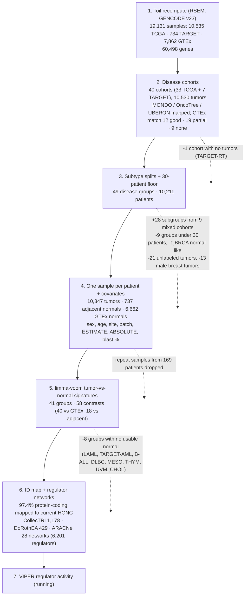

# Disease Cohort Funnel

> **Status 2026-10-31: v1 snapshot (2026-10-02).** Steps 1-3 (cohorts, patients) are unchanged in v2; for everything after, see [`PIPELINE_V2.md`](PIPELINE_V2.md).

Snapshot 2026-10-02. Every number is read from the pipeline's result files (`results/step1`–`step5`). A styled version of this page is in [`pipeline_summary.html`](pipeline_summary.html) (open it in a browser).

## Genes kept

| Set | Genes |
|---|--:|
| All genes in Toil (GENCODE v23) | 60,498 |
| Extended: protein-coding + lincRNA + antisense | 33,040 |
| Protein-coding (used for drug matching) | 19,797 |
| Expressed per signature after `filterByExpr` (median; range 16,438–18,596) | 17,320 |

## The 49 disease groups

Patients = tumor patients after one-sample-per-patient. Normal counts are those used in each model (— = contrast not run, fewer than 10 normals). Genes = genes in the group's primary signature.

| Group | Disease | Patients | GTEx normal tissue (match) | Normals vs GTEx | Normals vs adjacent | Genes |
|---|---|--:|---|--:|--:|--:|
| `ALL-B` | B-cell acute lymphoblastic leukemia | 149 | — (none) | — | — | — |
| `TARGET-AML` | childhood acute myeloid leukemia | 162 | — (none) | — | — | — |
| `TARGET-NBL` | neuroblastoma | 155 | Adrenal Gland (partial) | 125 | — | 17,370 |
| `TARGET-WT` | Wilms tumor | 121 | Kidney - Cortex (partial) | 28 | — | 17,987 |
| `TCGA-ACC` | adrenal cortex carcinoma | 77 | Adrenal Gland (good) | 125 | — | 16,893 |
| `TCGA-BLCA` | bladder transitional cell carcinoma | 407 | Bladder (partial) | — | 19 | 17,670 |
| `BRCA-Basal` | breast carcinoma, PAM50 basal-like | 190 | Breast - Mammary Tissue (good) | 79 | 17 | 17,461 |
| `BRCA-Her2` | breast carcinoma, PAM50 HER2-enriched | 81 | Breast - Mammary Tissue (good) | 79 | — | 17,069 |
| `BRCA-LumA` | breast carcinoma, PAM50 luminal A | 560 | Breast - Mammary Tissue (good) | 79 | 62 | 17,348 |
| `BRCA-LumB` | breast carcinoma, PAM50 luminal B | 209 | Breast - Mammary Tissue (good) | 79 | 22 | 17,399 |
| `CESC-AD` | cervical adenocarcinoma | 47 | Cervix - Ectocervix; Cervix - Endocervix (partial) | 7 | — | 17,341 |
| `CESC-SCC` | cervical squamous cell carcinoma | 252 | Cervix - Ectocervix; Cervix - Endocervix; Vagina (partial) | 87 | — | 17,362 |
| `TCGA-CHOL` | cholangiocarcinoma | 36 | — (none) | — | — | — |
| `TCGA-COAD` | colon adenocarcinoma | 288 | Colon - Transverse (good) | 165 | 41 | 17,270 |
| `TCGA-DLBC` | diffuse large B-cell lymphoma | 47 | — (none) | — | — | — |
| `ESCA-AD` | esophageal adenocarcinoma | 89 | Esophagus - Mucosa; Esophagus - Gastroesophageal Junction (partial) | 317 | 10 | 17,379 |
| `ESCA-SCC` | esophageal squamous cell carcinoma | 92 | Esophagus - Mucosa; Esophagus - Gastroesophageal Junction (partial) | 317 | — | 17,098 |
| `TCGA-GBM` | glioblastoma | 160 | Brain - Cortex; Brain - Frontal Cortex (Ba9) (good) | 151 | — | 17,596 |
| `TCGA-HNSC` | head and neck squamous cell carcinoma | 518 | Esophagus - Mucosa (partial) | 269 | 44 | 17,431 |
| `TCGA-KICH` | chromophobe renal cell carcinoma | 66 | Kidney - Cortex (partial) | 28 | 25 | 17,281 |
| `TCGA-KIRC` | clear cell renal carcinoma | 530 | Kidney - Cortex (partial) | 28 | 72 | 17,598 |
| `TCGA-KIRP` | papillary renal cell carcinoma | 288 | Kidney - Cortex (partial) | 28 | 32 | 17,279 |
| `TCGA-LAML` | acute myeloid leukemia | 173 | — (none) | — | — | — |
| `LGG-IDHmut-codel` | oligodendroglioma, IDH-mutant and 1p/19q-codeleted | 173 | Brain - Cortex; Brain - Frontal Cortex (Ba9) (good) | 151 | — | 17,217 |
| `LGG-IDHmut-noncodel` | astrocytoma, IDH-mutant | 241 | Brain - Cortex; Brain - Frontal Cortex (Ba9) (good) | 151 | — | 17,271 |
| `LGG-IDHwt` | lower-grade glioma, IDH-wildtype | 94 | Brain - Cortex; Brain - Frontal Cortex (Ba9) (good) | 151 | — | 17,143 |
| `TCGA-LIHC` | hepatocellular carcinoma | 369 | Liver (good) | 109 | 50 | 17,079 |
| `TCGA-LUAD` | lung adenocarcinoma | 513 | Lung (good) | 266 | 59 | 17,478 |
| `TCGA-LUSC` | squamous cell lung carcinoma | 498 | Lung (good) | 266 | 50 | 17,683 |
| `TCGA-MESO` | pleural mesothelioma | 87 | — (none) | — | — | — |
| `TCGA-OV` | ovarian serous cystadenocarcinoma | 422 | Ovary (partial) | 88 | — | 17,651 |
| `TCGA-PAAD` | pancreatic adenocarcinoma | 178 | Pancreas (partial) | 165 | — | 17,123 |
| `PCPG-PGL` | paraganglioma | 31 | Adrenal Gland (partial) | 125 | — | 16,438 |
| `PCPG-PHEO` | adrenal pheochromocytoma | 146 | Adrenal Gland (partial) | 125 | — | 17,099 |
| `TCGA-PRAD` | prostate adenocarcinoma | 495 | Prostate (good) | 100 | 51 | 17,477 |
| `TCGA-READ` | rectum adenocarcinoma | 92 | Colon - Transverse (partial) | 165 | 10 | 17,016 |
| `SARC-DDLPS` | dedifferentiated liposarcoma | 57 | Adipose - Subcutaneous; Adipose - Visceral (Omentum) (partial) | 385 | — | 17,072 |
| `SARC-LMS` | leiomyosarcoma | 104 | Muscle - Skeletal (partial) | 379 | — | 16,979 |
| `SARC-UPS` | undifferentiated pleomorphic sarcoma / myxofibrosarcoma | 76 | Muscle - Skeletal; Adipose - Subcutaneous; Adipose - Visceral (Omentum) (partial) | 478 | — | 16,597 |
| `TCGA-SKCM` | cutaneous melanoma | 466 | Skin - Not Sun Exposed (Suprapubic); Skin - Sun Exposed (Lower Leg) (partial) | 394 | — | 17,573 |
| `TCGA-STAD` | gastric adenocarcinoma | 414 | Stomach (good) | 172 | 36 | 17,708 |
| `TGCT-NSGCT` | testicular non-seminomatous germ cell tumor | 70 | Testis (good) | 165 | — | 18,596 |
| `TGCT-SEM` | testicular seminoma | 62 | Testis (good) | 165 | — | 18,450 |
| `TCGA-THCA` | thyroid gland papillary carcinoma | 504 | Thyroid (good) | 272 | 59 | 17,308 |
| `TCGA-THYM` | thymoma | 119 | — (none) | — | — | — |
| `UCEC-EEC` | endometrial endometrioid adenocarcinoma | 107 | Uterus (partial) | 78 | 10 | 17,199 |
| `UCEC-SER` | endometrial serous adenocarcinoma | 60 | Uterus (partial) | 78 | — | 17,324 |
| `TCGA-UCS` | uterine carcinosarcoma | 57 | Uterus (partial) | 78 | — | 17,540 |
| `TCGA-UVM` | uveal melanoma | 79 | — (none) | — | — | — |

## Groups excluded

| Group | Disease | Patients | Reason |
|---|---|--:|---|
| `BRCA-Normal` | breast carcinoma, PAM50 normal-like | 39 | PAM50 normal-like reflects low tumor content |
| `TARGET-AML-IF` | childhood acute myeloid leukemia | 24 | fewer than 30 patients |
| `UCEC-MIX` | mixed serous and endometrioid | 13 | fewer than 30 patients |
| `TARGET-CCSK` | clear cell sarcoma of kidney | 13 | fewer than 30 patients |
| `SARC-SS` | synovial sarcoma | 10 | fewer than 30 patients |
| `SARC-MPNST` | malignant peripheral nerve sheath tumor | 9 | fewer than 30 patients |
| `CESC-ADSQ` | cervical adenosquamous carcinoma | 5 | fewer than 30 patients |
| `SARC-DES` | desmoid tumor | 2 | fewer than 30 patients |
| `ALL-T` | T-cell acute lymphoblastic leukemia | 1 | fewer than 30 patients |
| `TARGET-RT` | rhabdoid tumor of the kidney | 0 | fewer than 30 patients |

Scope for Steps 8–10 (clustering and validation): BRCA and COAD/READ. Hematologic groups are de-prioritized (limited and more variable data); see `normal_reference_search.md`.
