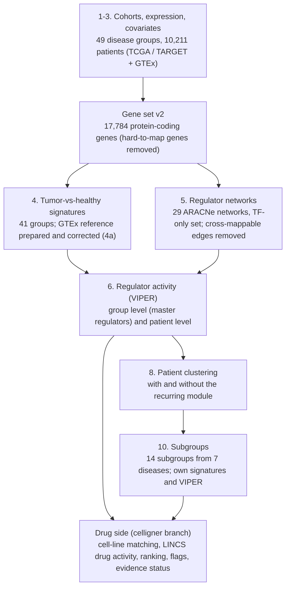

# Pipeline v2: steps, decisions and outputs

Last updated 2026-10-31. This is the reference for how the v2 pipeline runs, step by step: what each step does and
why, the exact command, what it reads and writes, which decisions shape it, the checks it reports, and where it
stands. The full reasoning behind each decision is in [`DECISIONS.md`](DECISIONS.md) (D-numbers below); the run
history with all numbers is in [`PROGRESS.md`](PROGRESS.md); the agreed rebuild plan is
[`SPEC_rebuild_v2.md`](SPEC_rebuild_v2.md). The drug side lives on the `celligner` branch and is documented in
`celligner:docs/PIPELINE_DRUG_SIDE_V2.md`. Terms new in v2: [`GLOSSARY_V2.md`](GLOSSARY_V2.md).

To run the steps in order: [`scripts/run_v2.sh`](../scripts/run_v2.sh) (`scripts/run_v2.sh list` shows the steps;
`scripts/run_v2.sh <step>` runs one). To see which outputs exist for the active build: `Rscript scripts/00_status.R`.

## What the pipeline does

The goal is to find drugs that push a cancer's regulator activity back toward healthy tissue.

## Conventions that apply to every step

- **Rules are fixed before results are looked at** and recorded in `DECISIONS.md`, then reported whatever they show
  (D19, D53). When a rule turns out to be wrong it is corrected openly (e.g. the COAD rounding in D71).
- **Builds are named, never mixed.** `config/builds.yaml` lists each build with all its paths; `R/paths.R` resolves
  them. Active build: `v2_tf_xmap` (v2 gene set, cross-mappable edges removed, TF-only regulators, D64). v1 outputs
  are kept for comparison; v2 writes to `_v2` paths (D53).
- **Script switches.** Most scripts take environment variables: `VERSION=v2` (v2 inputs and outputs),
  `REGSET=tf` (TF-only regulator set), `REGULON=aracne_project | collectri | dorothea_ABC` (regulon set),
  `STRATA=<file>` (subgroups instead of groups), `ONLY_GROUPS`, `N_CORES`. Each script's header lists its own.
- **Machines.** ARACNe builds ran on MAIL-15; everything else runs on MAIL-10. Large intermediate files
  (`data/processed`, `*.tsv.gz`) are not in git.

## Step overview

| Step | What | Main scripts | Status (2026-10-29) |
|---|---|---|---|
| 1-2 | Disease groups, expression data | `10_ground_toil.py`, `11_split_subtypes.py` | unchanged from v1 |
| 3 | Covariates; v2 gene set | `20_covariates.py`, `21_estimate.R`, `22_gene_set_v2.py` | done 10-18 |
| 4 | Tumor-vs-healthy signatures (GTEx reference prepared in 4a) | `32_gtex_reference.R`, `30_signatures.R`, `37_step4_v2_checks.R` | done 10-20 |
| 5 | ARACNe networks and regulons | `42`, `43`, `44`, `45`, `46` | done 10-25 (TF-only edge confounding 10-29) |
| 6 | VIPER: master regulators (group) and patient scores | `50_viper.R`, `56`, `61`, `63`, `64`, `65` | done; null fixed and rerun 10-28 |
| 7 | Master-regulator rules, diagnostics | `51`, `59`, `62`, `58`, `46` | done 10-29 on the corrected null |
| 8 | Patient clustering, subgroup keep rule | `80`, `84` | done 10-28 |
| 9 | Replication in external cohorts | `90`-`94` | not run on v2 |
| 10 | Subgroups: signatures, VIPER, variability, what defines them | `85`, `30` / `50` STRATA=, `86`, `87` | done 10-29 |
| Drug | Cell lines, drug activity, ranking, flags, literature, FDA | celligner `74b`, `79b`, `79d`-`79p` | done 10-29; PRISM / GDSC validation on hold |

---

## Steps 1-2. Disease groups and expression data (unchanged from v1)

- **What:** the Toil recompute of TCGA, TARGET and GTEx (RSEM, GENCODE v23); cancer cohorts mapped to disease
  ontologies; mixed cohorts split into subtypes (PAM50 breast, IDH / 1p19q glioma, etc.); groups with < 30 patients
  dropped. One sample per patient.
- **Outputs:** `results/step1/disease_groups_toil.tsv` (49 groups, 10,211 patients), counts cached in
  `data/processed/step4/counts_protein_coding.rds`.
- **Decisions:** see `PROJECT_SETUP_NOTES.md` and the early D-numbers. Snapshot of the funnel:
  [`PIPELINE_SUMMARY.md`](PIPELINE_SUMMARY.md) (v1 numbers, still valid for these steps).

## Step 3. Covariates and the v2 gene set

**Covariates** (`scripts/20_covariates.py`, `21_estimate.R` -> `results/step3/covariates_toil.tsv`):
sex, age, site, plate, sample type, ESTIMATE purity, and for GTEx the collection variables (ischemic time, death
circumstance ventilator / fast / slow, autolysis).
- **ESTIMATE purity everywhere, including LGG (D45).** Why: it exists for tumors and normals alike, so it is the only
  purity measure usable in tumor-vs-normal models. (Open: whether LGG also needs ABSOLUTE, A37, tabled.)
- **RNA-quality index is not used in signatures (D50)**, only for patient-level correction. Why: computed across
  tumors and normals together it mixes RNA quality with tissue type.

**Gene set v2** (`scripts/22_gene_set_v2.py` -> `results/step3/genes_protein_coding_v23_v2.tsv`, dropped genes and
reasons in `genes_v2_dropped.tsv`):
- **Drop genes that cannot be measured reliably (D46):** mappability < 0.8 (reads also map elsewhere in the genome)
  and readthrough loci (transcripts that run across two genes). 2,013 of 19,797 protein-coding genes dropped,
  **17,784 kept**. Why: these genes produced artifacts (the AGAP4/5/6/9 paralogs in the recurring module, multi-mapping
  noise) in signatures and networks.
- Genes without a mappability value are kept and flagged (D54).
- Mappability file note: `_PAR_Y` rows (Y copies of pseudoautosomal genes) have mappability 0 and are skipped.

## Step 4. Tumor-vs-healthy signatures

**4a. Prepare the GTEx healthy reference** (`scripts/32_gtex_reference.R` -> `results/step4_v2/gtex_reference.tsv`):
- **Remove samples from the wrong part of the organ (D59).** Colon: keep transverse-colon samples with an epithelial
  marker score >= 7 (drops muscle-wall samples, 165 -> 109). Kidney: keep cortex samples with a proximal-tubule
  score >= 5 (28 -> 21). Why: the tumor arises from epithelium, so muscle or medulla samples would put tissue
  composition differences into the signature.
- **Correct GTEx for how the body was collected (D57).** Post-mortem samples differ by ischemic time and how the donor
  died. Each tissue gets an "anchor": the best-preserved donors (ventilator cases, short ischemic time, low autolysis).
  Collection covariates are centered at that anchor, so the signature compares tumors with a well-preserved donor.
  Why: removes post-mortem decay from the signature without using TCGA normals, which differ from GTEx in more than
  lab handling (surgery vs death, cancer patients vs donors, tissue next to a tumor).
- **GTEx stays the healthy reference; TCGA adjacent normals are a check only (D57, D58).**
- Kidney has only 21 reference donors after the filter (D60, open for the PI).

**4b. Signatures** (`VERSION=v2 Rscript scripts/30_signatures.R`):
- limma model `~ condition + age + sex + ESTIMATE + sample-type indicators + collection covariates`; moderated t
  converted to a signed z per gene. Sex is left out when a group has one sex or its smaller sex has < 3 samples (the
  second case does not occur in v2). Two contrasts per group where possible: vs GTEx (primary) and vs adjacent normals
  (check).
- **voomByGroup instead of voom (D69).** Tumors are 1.2-1.8x more variable than normals; separate noise models give
  each arm its own weights. Why the user chose it: top-of-list genes and regulator lists shift 10-30%, which matters
  for the drug side even though whole rankings barely move.
- **Outputs:** `results/step4_v2/{z_tumor_vs_gtex,z_tumor_vs_adjacent,signature_summary}.tsv`;
  full tables `data/processed/step4_v2/<group>__<contrast>.tsv.gz`. 41 groups have a usable signature.
- **Checks** (`scripts/37_step4_v2_checks.R` -> `results/step4_v2/checks/`): agreement with adjacent-normal
  signatures up (median 0.59 -> 0.65); post-mortem signal closer to 0 in 28 of 39 groups; proliferation kept in 38 of
  40; GC tilt larger (median -0.24 -> -0.30) and accepted (D70: partly real, corrected only if it applied to all
  cohorts).

## Step 5. Regulator networks (ARACNe)

- **Inputs** (`VERSION=v2 python scripts/42_aracne_inputs.py` -> `data/processed/step5/aracne_inputs_v2/`): per cohort,
  tumors only, v2 gene set, genes expressed in >= 10% of tumors. COAD + READ pooled. Plus a luminal-only breast
  network BRCA_LUM (D65). 29 networks.
- **Identity vs signaling edges** (`48_identity_edges.R`, D82; diagnostic, regulons unchanged): every edge of the TF-only
  networks is tested against subtype labels: histology / cell type (our subtype groups: BRCA PAM50, CESC, ESCA, LGG,
  PCPG, SARC, TGCT, UCEC, COAD vs READ) and established molecular subtypes (TCGA PanCanAtlas `Subtype_mRNA`, else
  `Subtype_Selected`). Per edge: pooled Spearman vs the correlation left after removing each subtype's average.
  **Identity-only** = keeps < 50% (or flips sign); **signaling** = keeps >= 50%; **weak** = pooled |rho| < 0.1. Flag
  **subtype-specific** = |rho| >= 0.3 in one subtype of >= 50 tumors and < 0.1 or opposite in another (rewiring, A9).
  Outputs `results/step5/identity_edges_v2_tf/` (per edge, per regulon, per network).
  *Result (2026-11-01):* identity-only edges are 0-7% of each network, but concentrate in lineage regulators, the
  ones drugs are read through: BRCA ESR1 51% of targets, XBP1 46%, GATA3 45%, FOXA1 35% (MYC 1%, E2F1 7%); ESCA
  HNF1A / HNF1B / FOXA2 / FOXA3 / PDX1 82-89%, HNF4A 73%, GATA6 58%, TP63 47%; BLCA molecular GATA3 75%, PPARG 74%.
  Highest per network: ESCA 6-7%, LGG / TGCT 4%, SARC 3.5%, BRCA 3.3%; COADREAD 0%.
  *In plain language:* a network built from mixed tumor types can list a gene as a regulator's target only because
  both genes are high in one tumor type and low in another. Those "identity" links describe what a cell is; a drug,
  which acts within hours, cannot change them. The step checks every link: if it disappears once tumor type is taken
  into account, it is identity; if it remains inside each tumor type, it is signaling. Most links are signaling, but
  for the regulators that define a tumor type (ESR1 in breast, HNF4A or TP63 in esophagus) about half are identity,
  so drugs acting on them may be misread. Whether to score drugs with signaling-only lists is a separate decision.
- **Signaling-only target lists** (`49_signaling_regulons.R`, D83; comparison, production lists unchanged): from the
  TF-only lists, drop the D82 identity-only edges, keep signaling and weak ones as they are. **sig1** (main): identity
  under the histology labels; **sig2**: histology or molecular labels; **base**: the current lists under a separate name.
  sig1 removes 0.2-5.8% of edges in the 8 networks with histology labels (COADREAD none) and puts 12 regulators below
  10 targets; sig2 changes 25 networks. All three arms run group VIPER with one fixed seed per group (`50_viper.R`
  `SEED_GROUP=1 GROUP_ONLY=1`), so they share the null; then the drug side (celligner `scripts/d83_run.sh`).
  *In plain language:* we remove the links that only reflect tumor type, rerun everything with the cleaner lists and
  the current ones side by side, and keep the cleaner lists only if anti-estrogens move up in luminal breast cancer
  without the knockdown test or the known-biology checks getting worse (D83).
  *Result (2026-11-01):* the rule is met for both arms but the effect is small: anti-estrogens LumA 9.7 -> 12.3, LumB
  23.4 -> 26.0 (percentile of `spec_mech`); knockdown 0.597 -> 0.599; controls unchanged (77 / 4); drug rankings almost
  unchanged (median rho 1.00, lowest 0.986). The remaining problem is on the drug side: ARACNe's ESR1 list reads
  anti-estrogens in MCF7 as ESR1 activation even without identity links (CollecTRI reads inhibition); see C25.
- **BRCA_LUM size-matched controls** (`python scripts/47_brca_size_controls.py`, D81): BRCA_SUB1-3, 769 tumors each drawn
  at random from all 1,040 BRCA tumors (seeds 1-3), built like BRCA_LUM; TF-only build on MAIL-10; regulons with
  `OUT_TAG=_brca_controls` into a separate file, so they never enter the production regulon set.
- **Build** (`VERSION=v2 [REGSET=tf] scripts/43_run_aracne.sh`, MAIL-15, ~2.5 days + ~0.7 days): ARACNe-AP, 100
  bootstraps, DPI, as v1 (D51). Two regulator sets (D64): full (5,789 candidates) and **TF-only** (Lambert TFs,
  ~1,100-1,360 per network). Why TF-only: comparable with CollecTRI / DoRothEA, and drops non-TF "regulators" that only
  mark proliferation (MKI67, TOP2A).
- **Regulons** (`VERSION=v2 [REGSET=tf] Rscript scripts/44_aracne_regulons.R` ->
  `data/processed/step5/regulons_aracne_project_v2[_tf].rds`): **edges between cross-mappable genes are removed
  before the regulons are made** (11-15% of edges; counts in `results/step5/crossmap_edges_removed_v2[_tf].tsv`).
  Why: paralog pairs share reads, so their correlation is partly a mapping artifact, and they are among the strongest
  edges.
- **Diagnostics:** bootstrap support (`45_edge_support.R` -> `results/step5/aracne_edge_support_v2[_tf].tsv`); edge
  confounding (`46_edge_confounding.R` [REGSET=tf] -> `aracne_edge_confounding_v2[_tf].tsv`): edges that lose half
  their strength after purity, quality and plate adjustment, median 1.9% (full set) and 4.0% (TF-only; max UCS 12%).
- No proliferation regression of the network input (D66).

## Step 6. Regulator activity (VIPER)

**6a. Group level: master regulators** (`REGULON=aracne_project VERSION=v2 REGSET=tf Rscript scripts/50_viper.R`; also
`REGULON=collectri` and `REGULON=dorothea_ABC` with `VERSION=v2`, and the full set without `REGSET`):
- msviper on each group's signature. Regulators kept if expressed in the tumors (median logCPM >= 1) with >= 10 targets
  and >= 50% of targets measured.
- **Null (what counts as chance):** 1,000 random splits of the group's healthy samples into two halves.
  **Fixed 2026-10-28 (D73):** the null now uses exactly the GTEx samples the signature used (Step 4a set); before,
  it used all of a group's GTEx samples.
- **Covariate-adjusted null tested, not adopted (D73;** `scripts/64_null_adjust_test.R` ->
  `results/step6/null_adjust_test/`). It made no false calls and found more master regulators, but lost one
  known-biology control, so by the rule set before running it was not adopted. Available as `NULL_ADJUST=1`.
- **Key finding:** FDR-cut master-regulator lists are unstable (colon 425 / 0 / 1 between nulls) while the regulator
  ranking is stable (Spearman >= 0.98). This is why the drug side weights every regulator by its NES (D74).
- **Outputs** (per regulon set, e.g. `results/step6/aracne_project_v2_tf/`): `group_mr.tsv` (regulator, NES, p, FDR per
  group), `regulator_filter.tsv`, `group_summary.tsv`, `patient_concordance.tsv`, `axes.tsv`. `50` also writes
  **uncorrected** patient NES to `data/processed/step6/<set>/`; they are used only for its own diagnostics. Every
  downstream step uses the corrected patient NES from 6b (`data/processed/step6/<set>_patient/`).
- **Roles of the regulon sets:** ARACNe is primary; CollecTRI and DoRothEA are supporting evidence (D17); confirmed
  regulator rule D18. CollecTRI reaches FDR < 0.10 in few groups on the corrected null, which no longer matters for
  ranking (D74).

**6b. Patient level** (`VERSION=v2 REGSET=tf Rscript scripts/61_quality_correct.R`; purity part `56_purity_correct.R`):
- Each tumor's expression is corrected for ESTIMATE purity and RNA quality; the healthy samples are corrected for
  quality and collection covariates and set to the anchor; VIPER per patient against them.
- **Outputs:** `data/processed/step6/aracne_project_v2_tf_patient/<group>.patient_nes.tsv.gz`;
  checks `results/step6/aracne_project_v2_tf/quality_correction/` (patient concordance with the group profile,
  effective dimensionality, PC associations with purity / quality / plate).

**Checks** (`scripts/63_step6_v2_checks.R`, SET=full / tf -> `results/step6/checks_v2[_tf]/`): GC-only signature vs
master regulators (C2), known-biology controls (C5), master-regulator agreement v1 vs v2 (C7), network size (C9),
no cross-mappable edges or low-mappability genes left (C10 = 0). Results in `PROGRESS.md` 2026-10-25.

**Reference swap** (`scripts/65_reference_swap.R` -> `results/step6/reference_swap/`): master regulators with GTEx vs
adjacent-normal references for the 15 groups that have both (run 10-27, before the null fix).

## Step 7. Master-regulator diagnostics (rerun 2026-10-29 on the corrected null)

**Summaries and known-biology controls** (`REGULON=<set dir> Rscript scripts/51_compare_mr.R`, e.g.
`REGULON=aracne_project_v2_tf`; run for every v2 set and `_strata` dir -> `results/step6/<set>/fdr10_*.tsv`,
`controls.tsv`):
- Controls are regulators with known direction: E2F1 / FOXM1 / MYBL2 up in tumors; ESR1 / FOXA1 / GATA3 up in luminal
  breast; EPAS1 / HIF1A up in clear-cell kidney; HNF4A / HNF1A down in liver; AR / ERG up in prostate; MYC up in colon.
- TF arm: 77 pass, 55 correct direction below the cutoff, 4 wrong direction; every wrong-direction call has NES near 0
  and FDR >= 0.83 (no real contradiction). The null fix moved 5 of 139 verdicts across FDR 0.10, none changed
  direction.

**Three regulon sets compared; confirmed regulators** (`VERSION=v2 [REGSET=tf] [STRATA=1] Rscript
scripts/59_compare_regulon_sets.R` -> `results/step6/comparison_v2[_tf][_strata]/`):
- `confirmed.tsv` applies D18: ARACNe FDR < 0.05, or ARACNe FDR < 0.10 with a same-direction FDR < 0.10 call in
  CollecTRI or DoRothEA. TF arm: median 117 confirmed regulators per group (5,215 in total); subgroups median 80.
- **The curated sets rarely reach significance** (CollecTRI median 0 per group, DoRothEA 1), so in practice the
  confirmed list is ARACNe FDR < 0.05; the second part of D18 adds almost nothing. Few confirmed regulators in CESC-AD
  (0), BLCA, UCS, STAD (1 each), HNSC (4).
- **The sets disagree on ranking:** NES Spearman ARACNe vs CollecTRI median 0.18, vs DoRothEA 0.27, CollecTRI vs
  DoRothEA 0.37. Relevant to the drug-side consensus (D75), which averages ARACNe and CollecTRI.

**Regulator modules** (`NES_DIR=data/processed/step6/aracne_project_v2_tf_patient Rscript scripts/58_regulator_modules.R`
-> `results/step6/aracne_project_v2_tf/diagnostics/regulator_modules_v2_tf.tsv`): groups of regulators whose activity
moves together across patients, with the member that best represents each (hub), what share are TFs, whether the hub's
targets include the other members, and what the module tracks (plate, RNA-quality length index, proliferation).
714 modules (median 18 per group, 15 regulators each); 59 track proliferation (|r| >= 0.7), 62 track plate (R^2 >= 0.3).
The largest modules are often groups of KRAB zinc-finger TFs (ZNF333, ZNF224, ZNF141, ...), like the recurring module.

**Recurring module (C8,** `NES_DIR=data/processed/step6/aracne_project_v2_patient Rscript scripts/62_recurring_module.R`
-> `results/step6/aracne_project_v2/diagnostics/`): a group of ~50-80 regulators (PILRB, ZNF692, CCNL2, ...) that
co-varies across patients in 36 of 41 groups, tracks plate (excess over chance median 0.17) and not immune, purity or
quality. Tested and rejected as its cause: RNA quality, GC bias, multi-mapping. Treated as a technical nuisance for
subgrouping (D79; D26 awaits PI confirmation).

- **BRCA_LUM test** (`66_brca_lum_test.R`, D68 / D81): LumA and LumB group NES on pooled BRCA, BRCA_LUM and the three
  size-matched controls, with one shared null per group. Material if (a) the weighted Spearman of BRCA_LUM vs pooled is
  below every control's and >= 0.10 below their median, or (c) ESR1 / FOXA1 / GATA3 / XBP1 flips sign (|NES| >= 1.96 on
  one side) and no control shows that flip. Why the controls: BRCA_LUM differs from pooled BRCA both in size (769 vs
  1,040 tumors) and in subtype mix; the controls change only the size, so only the extra change is luminal rewiring.
  Outputs `results/step7/brca_lum_test/`. **Result (2026-11-01): not material.** (a) LumA 0.985 vs controls 0.994
  (below all, but by 0.01, not 0.10); LumB 0.989 vs 0.989-0.995. (c) no flips. LumA / LumB stay on the pooled network.
  Context: ESR1 and GATA3 read stronger on BRCA_LUM in LumB (1.76 -> 3.06, 1.48 -> 3.13).
- **Luminal regulon content** (`67_esr1_regulon_content.R`, descriptive, not in the D81 rule): for ESR1, FOXA1, GATA3 and
  XBP1 on each network, target overlap with the pooled regulon and the share of Hallmark estrogen-response genes (early +
  late). Why: D81 tests whether scores change, but a regulon can shift from luminal-identity genes to estrogen-responsive
  genes while its score keeps the same sign; that shift matters for how anti-estrogens read on the drug side.

  *In plain language:* when ESR1 looks "on" in a luminal tumor, is that because estrogen signaling is on, or only
  because the tumor is luminal-type? ARACNe calls a gene an ESR1 target when it rises and falls with ESR1 across tumors.
  In the pooled network (luminal + basal tumors), many "luminal genes" do that just because they are luminal, so they
  get counted as targets. In the luminal-only network those genes no longer stand out, so the list should be closer to
  what estrogen really controls. The check asks two things for ESR1 (and FOXA1, GATA3, XBP1): how much did the target
  list change, and does the new list contain more genes from a standard list of ~300 known estrogen-response genes,
  switched on by ESR1 as expected? A network built from fewer tumors changes its lists a bit anyway, so the same check
  runs on the three control networks; only a change bigger than theirs counts. It matters because drugs are scored with
  these lists: if ESR1's list is mostly luminal genes, an anti-estrogen may barely register (it switches off estrogen
  signaling but does not make a cell less luminal). The check decides nothing by itself; the D81 test does. It helps
  explain that result.
  *Result:* BRCA_LUM regulons are a third the size (ESR1 450 -> 154 targets; half shared with pooled vs ~70% for the
  controls) but not more estrogen-specific (9.1% estrogen-response genes vs 11.1% pooled, 10.4-11.9% controls). The
  ESR1 targets BRCA_LUM drops are mostly identity-only by D82 (59%), the ones it keeps mostly signaling (85%): two
  independent checks agree that the luminal network removes identity links, but it also loses many signaling ones.

## Step 8. Patient clustering and the subgroup keep rule

**Clustering** (`Rscript scripts/80_consensus_clustering.R`, build `v2_tf_xmap` -> `results/step8_v2_tf/`;
`EXCLUDE_MODULE=recurring` -> `results/step8_v2_tf_no_c8/`):
- **Features:** each group's corrected patient NES; regulators whose activities move together (|r| >= 0.7) form
  modules; each module becomes one score per patient. `modules10` (main) uses modules of >= 10 regulators;
  `all` (sensitivity) uses every module and single regulator. Why modules: a large correlated block (like the
  recurring module) would otherwise dominate the distances.
- **Method:** M3C consensus clustering (PAM, K = 2-10) against reference data without clusters; clusters accepted
  only if both p-values < 0.05 (D30). "No clusters" is an accepted answer.
- **Without the recurring module:** the module is removed before building features. The decision changed in only 5 of
  41 groups, mostly borderline ones.

**Keep rule (D71)** (`Rscript scripts/84_subgroup_consistency.R`; `STEP8_SUFFIX=_no_c8` for the no-module run ->
`results/step8_v2_tf[_no_c8]/consistency.tsv`). A clustering becomes subgroups only if all hold:

| Criterion | Threshold | Why |
|---|---|---|
| M3C significant (main feature set) | both p < 0.05 | real structure, not continuous variation |
| Prediction strength (clusters reproduce in held-out halves of the patients) | >= 0.75 | any 2-way split of unstructured data scores ~0.5-0.65 here |
| Smallest cluster | >= 30 patients | a subgroup needs its own signature |
| Agreement between the two feature sets | ARI >= 0.3 | not an artifact of how features were built |
| Plate (Cramer's V above chance) | < 0.1 | not a batch effect |
| Purity and RNA quality (R^2) | < 0.1 | not a sample-quality effect |

Correction: COAD (prediction strength 0.748) was first passed by rounding; strictly it fails (recorded in D71).

## Step 9. Replication (not run on v2)

v1 replicated the COAD split in GSE39582 and CPTAC-COAD (`90_process_replication_crc.R`, `91_replicate_crc.R`) and the
breast axes in METABRIC / CPTAC-BRCA (`93`, `94`). Planned for v2: the new subgroups in CPTAC-HNSCC, a bladder cohort,
and COAD again.

## Step 10. Subgroups

**Which subgroups (D79,** `Rscript scripts/85_step10_strata_v2.R` -> `results/step10_v2/strata.tsv`,
`stratum_patients.tsv`): every group passing D71 on the clustering without the recurring module, plus COAD as an
explicit exception (its MSI-like vs CIN-like split matches TCGA subtypes and was replicated in v1). 14 subgroups,
named from the TCGA subtypes of their members:

| Disease | Subgroups (patients) |
|---|---|
| TCGA-BLCA | basal-squamous-like (172) / luminal-like (235) |
| TCGA-HNSC | basal-mesenchymal-like (363) / atypical-classical-like (155) |
| LGG-IDHmut-noncodel | LGr2 (89) / LGr3 (152) |
| PCPG-PHEO | pseudohypoxia-Wnt (69) / kinase-signaling (77) |
| TCGA-THCA | BRAF-like-classical (296) / RAS-like-follicular (208) |
| TGCT-SEM | C1 (32) / C2 (30) |
| TCGA-COAD (exception) | CIN-like (194) / MSI-like (93) |

- **Signatures** (`VERSION=v2 STRATA=results/step10_v2/stratum_patients.tsv Rscript scripts/30_signatures.R` ->
  `results/step10_v2/{z_tumor_vs_gtex,z_tumor_vs_adjacent,signature_summary}.tsv`): each subgroup's tumors vs its
  parent's healthy samples, same v2 model.
- **VIPER at group and patient level** (`... STRATA=results/step10_v2/stratum_patients.tsv Rscript scripts/50_viper.R`,
  for the TF arm, CollecTRI and DoRothEA -> `results/step6/<set>_strata/`). Group level gives each subgroup's master
  regulators; patient level lets us measure how much patients vary inside a subgroup.
- **Variability inside subgroups** (`scripts/86_subgroup_variability.R` -> `results/step10_v2/variability*.tsv`):
  coherence of patients with their subgroup's profile, effective dimensionality, PC associations with plate, purity,
  quality. (Run on the earlier D72 subgroups; rerun for D79 pending.)
- **What defines each subgroup** (`scripts/87_subgroup_characterize.R` -> `results/step10_v2/defining_features.tsv`,
  `defining_top.tsv`): feature differences vs the sibling, with small programs (modules < 10 regulators, single
  regulators) marked. Many small programs are chromosome-19 zinc-finger groups; check before reporting.

## Drug side (celligner branch)

Summary; full detail in `celligner:docs/PIPELINE_DRUG_SIDE_V2.md` and caveats in
`celligner:docs/notes/drug_side_decisions_and_caveats.md` (C18-C23).

1. **Cell-line matching** (Celligner): each patient is matched to DepMap lines of the same tissue; disease and subgroup
   line weights (`74`, `74b`).
2. **Drug activity:** LINCS drug signatures in cancer lines, each line's average drug response removed, scored with
   VIPER on the ARACNe TF regulons and on CollecTRI (`79c`, `79d`).
3. **Target check** (`79b`): a drug stays on a disease's list if one of its targets is expressed.
4. **Ranking** (`79l` -> `79e` -> `79i`): every regulator weighted by its disease NES (D74); consensus of ARACNe TF and
   CollecTRI (D75); flags for drugs tested only in unlike cell lines (D76) and for borrowed drugs with low transfer
   confidence (D77); evidence status per disease (D78); proliferation split; reports lead with specificity (D80).
5. **Literature and FDA** (`79o`, `79p`): PubMed / ClinicalTrials.gov links for top pairs; FDA-approved rankings from
   Drugs@FDA; browsable page `celligner:results/lincs/fda_rankings_v2.html`.

## Where the main outputs are

| Question | File |
|---|---|
| Which groups and patients? | `results/step1/disease_groups_toil.tsv`, `results/step3/covariates_toil.tsv` |
| Tumor-vs-healthy signature of a group | `results/step4_v2/z_tumor_vs_gtex.tsv` (z per gene) |
| A group's master regulators | `results/step6/aracne_project_v2_tf/group_mr.tsv` (+ `collectri_v2`, `dorothea_ABC_v2`) |
| A patient's regulator activity | `data/processed/step6/aracne_project_v2_tf_patient/<group>.patient_nes.tsv.gz` |
| Does a group have subgroups? | `results/step8_v2_tf_no_c8/consistency.tsv`, `decision.tsv` |
| Subgroups and their patients | `results/step10_v2/strata.tsv`, `stratum_patients.tsv` |
| A subgroup's master regulators | `results/step6/aracne_project_v2_tf_strata/group_mr.tsv` |
| Drug ranking per disease / subgroup | celligner `results/lincs/drug_reversal_split_v2_consensus.tsv`, `stratum_reversal_split_v2_consensus.tsv` |
| Evidence status per disease | celligner `results/lincs/drug_reversal_summary_v2_consensus.tsv` |
| FDA-approved drugs per cohort | celligner `results/lincs/fda_ranking_v2_consensus.tsv`, `fda_rankings_v2.html` |

## Open items

- D26 recurring module: subgroups are defined without it (D79); PI to confirm.
- D60 kidney reference; A37 LGG purity covariate (tabled).
- **BRCA_LUM test (D65, D68, D81): done, not material** (2026-11-01). LumA / LumB stay on the pooled network.
- **Signaling-only regulons (D82 follow-up):** decide whether drugs are scored on regulons without identity-only edges,
  and the validation rule (knockdown benchmark, controls, anti-estrogens) before looking.
- Step 7 questions (2026-10-29): keep the D18 confirmed rule as is (its curated part adds almost nothing)? Does the low
  ARACNe vs CollecTRI agreement change the drug-side consensus (D75)? TF-only networks lose more edges to technical
  adjustment (4.0% vs 1.9%; UCS 12%).
- Step 9 replication of the new subgroups; `86` variability rerun for the D79 subgroups.
- Drug side: PRISM / GDSC validation on hold; confirm or drop the oddities in specificity lists (cardiac glycosides,
  pentobarbital, metronidazole).
